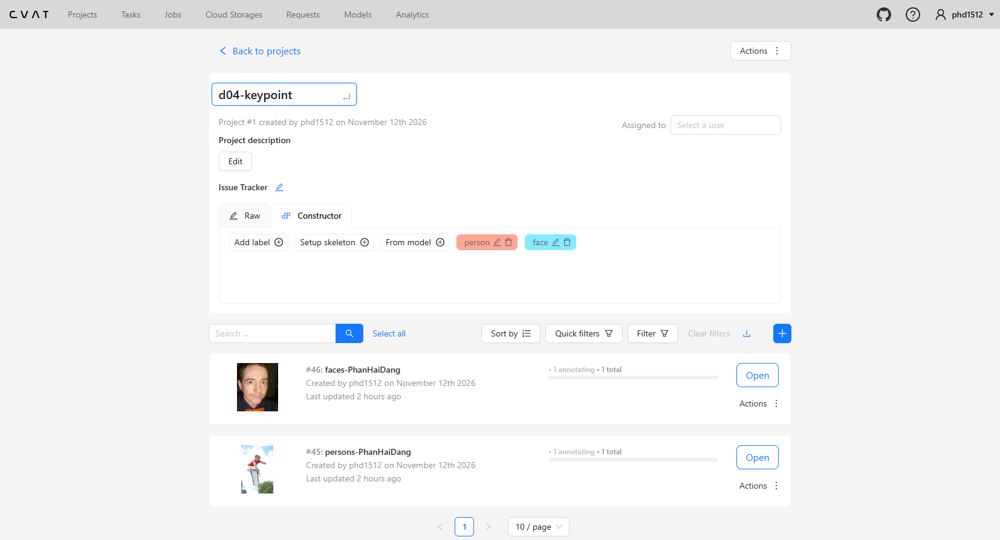
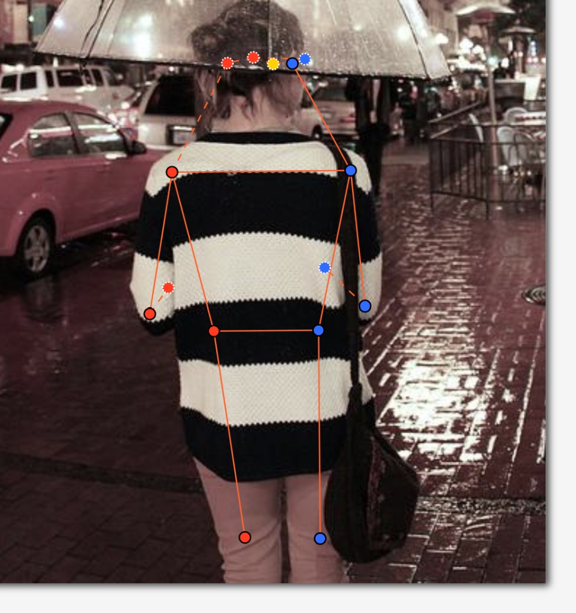
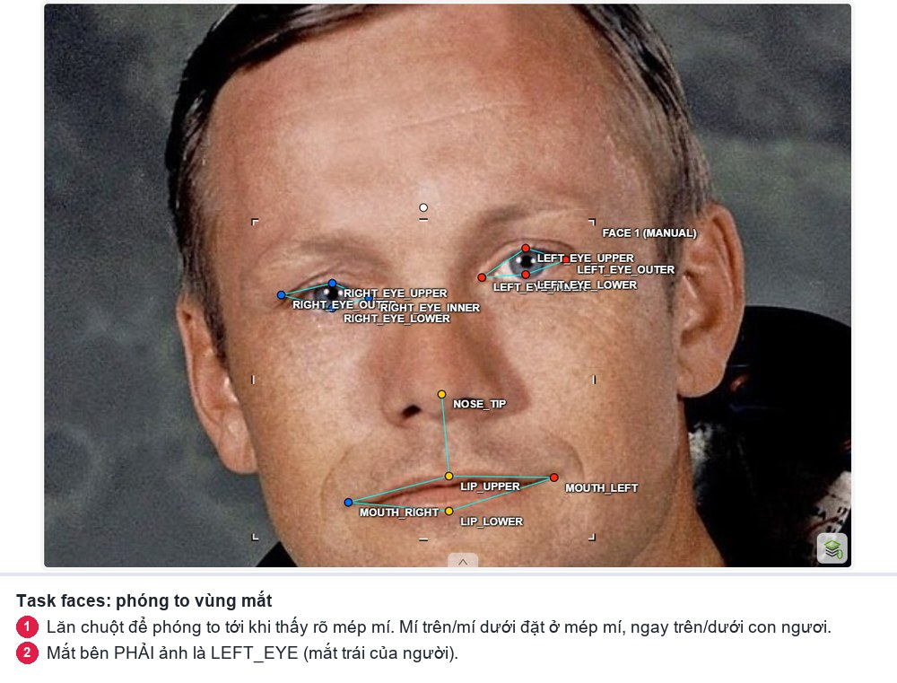
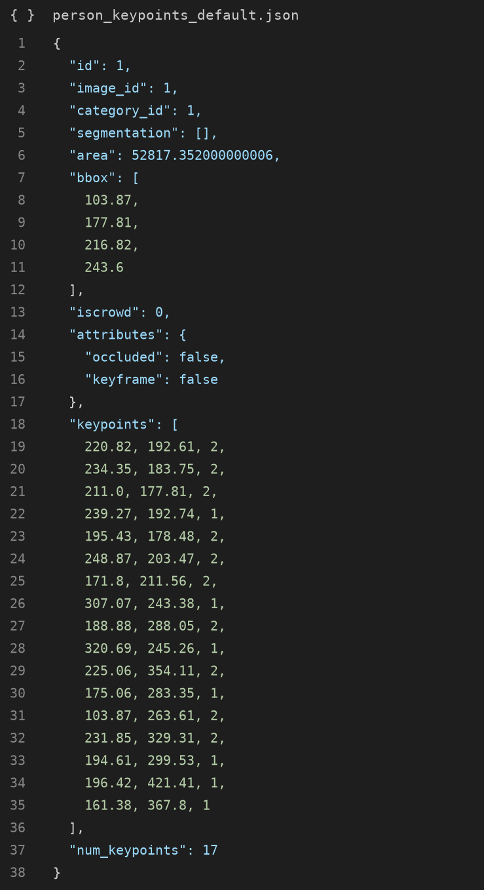

# Báo cáo cá nhân — PhanHaiDang-2A202603229

Đổi tên file theo quy tắc `MSSV_HoTen.md`. Ví dụ: `2A202603229_PhanHaiDang.md`.

Dữ liệu: 12 ảnh người COCO val2017 (Lin et al., 2014) và 8 ảnh chân dung Wikimedia Commons, chỉ dùng trong lớp.

## 0. Thông tin học viên

- Họ tên: Phan Hải Đăng
- MSSV: 2A202603229
- Email: 26ai.dangph4@vinuni.edu.vn
- Link repository: https://github.com/phdang95/K5-L2A-DAY04-PhanHaiDang-2A202603229-KeypointPose-Student
- Phiên bản CVAT (Help → About): 2.74.1
- Máy: hệ điều hành Windows 11 / WSL2 · RAM 16 GB · chạy CVAT chế độ đầy đủ
- Bộ ảnh (`src/exports/assignment.json` do `lab.py setup` tạo): có
- Giờ bắt đầu: 17:00
- Giờ kết thúc: 19:15

## 1. Kiểm tra label (CP0)

| Label | Kiểu | Số điểm | Tên điểm đúng bảng của lab? | Đúng thứ tự? | Số cạnh |
|---|---|---:|---|---|---:|
| `person` | Skeleton | 17 | Có | Có | 19 |
| `face` | Skeleton | 13 | Có | Có | 13 |

Mẫu `person` dựng theo người quay mặt về camera (các điểm `left_*` nằm bên phải khung mẫu)? Có

Cách đổi cờ `occluded` / `outside` cho **một điểm** trên phiên bản CVAT này (một câu):
Rê chuột vào đúng điểm đó và bấm phím `Q` để bật/tắt cờ `occluded` (v = 1), hoặc bấm phím `O` để bật/tắt cờ `outside` (v = 0).

## 2. Số lượng đã gán và thời gian (CP1, CP2)

| Nhóm ảnh | Số ảnh | Số skeleton đã gán | Số người dưới 60 px (không gán) | Số poster / gương / màn hình bỏ qua | Thời gian (phút) |
|---|---:|---:|---:|---:|---:|
| `easy` | 5 | 5 | 0 | 0 | 35 |
| `occluded` | 3 | 5 | 0 | 0 | 30 |
| `back` | 2 | 2 | 0 | 0 | 20 |
| `small` | 1 | 2 | 1 | 0 | 15 |
| `crowd` | 1 | 4 | 25+ | 0 | 25 |
| `faces` | 8 | 8 | — | 0 | 30 |

- Số ảnh người đã xong ở mốc phút 105: 12 / 12
- Thời gian thực tế (phút): CP1 60 · CP2 55 · CP3 20
- Ảnh tốn thời gian nhất là ảnh nào, vì sao?
Ảnh `000000130816.jpg` (nhóm crowd) và ảnh `000000019754.jpg` (người lướt ván CSB). Ảnh crowd vì  có rất nhiều người nhỏ số lượng skeleton nhiều nhất, và người phía trước che khuất người phía sau nên phải ước lượng chi tiết từng khớp. Ảnh lướt ván (ảnh đầu tiên) tư thế cơ thể nghiêng vặn xoắn, tay trước tay sau và chân bị ván che khuất cần phân biệt dụng cụ thể thao với khớp cơ thể.

## 3. Bảng ca khó (CP1, CP2)

Mỗi điểm bạn phân vân một dòng, nhất là phân vân giữa `v = 1` và `v = 0`, hoặc không chắc hướng người.

| Ảnh | Người / mặt | Điểm | Cờ đã chọn | Phân vân giữa | Lý do chọn |
|---|---|---|---:|---|---|
| `000000019754.jpg` | Người lướt ván CSB | `left_knee`, `left_ankle`, `right_knee`, `right_ankle` | `v = 1` | `v = 1` và `v = 0` | Chọn `v = 1` (`occluded`) vì chân nằm ngay sau mặt ván boogie board, hướng giải phẫu của đùi và cẳng chân ước lượng được chắc chắn. |
| Kỵ sĩ nhảy rào | Kỵ sĩ cưỡi ngựa | `left_hip`, `left_knee`, `left_ankle` | `v = 1` | `v = 1` và `v = 0` | Chọn `v = 1` vì kỵ sĩ nhảy rào kẹp 2 chân đối xứng 2 bên sườn ngựa qua yên, chân trái nằm song song ngay sau chân phải. |
| Cô gái cầm ô trời mưa | Người quay lưng | `nose`, `left_eye`, `right_eye` | `v = 1` | `v = 1` và `v = 0` | Người quay lưng hoàn toàn nên mắt và mũi nằm ở mặt trước bị đầu che, ước lượng được chắc chắn vị trí đối diện gáy. |
| Kỵ sĩ nhảy rào | Kỵ sĩ cưỡi ngựa | `right_knee` | `v = 1` | `v = 2` và `v = 1` | Cột rào nhảy màu vàng che ngang đầu gối phải nên không thấy trực tiếp da/quần, chọn `occluded` (v = 1). |

## 4. Bảng tự review (CP3)

Đi từ ảnh cuối về ảnh đầu. 5 ảnh người (ít nhất 2 ảnh `back` hoặc `crowd`) và 3 ảnh mặt. Ít nhất 8 dòng, kể cả dòng `ok`. Ghi lỗi trước, sửa sau.

Mã lỗi dùng đúng một trong: `lr_swap`, `vis_flag`, `position`, `missing`, `extra`, `ok`.

| Ảnh | Người / mặt | Điểm | Mã lỗi | Ghi chú | Đã sửa? |
|---|---|---|---|---|---|
| `000000019754.jpg` | Người lướt ván | toàn bộ | `lr_swap` | Ban đầu nhìn theo hướng người xem màn hình nên bị ngược trái/phải | Đã sửa: xoá vẽ lại đúng chiều cơ thể người |
| `000000019754.jpg` | Người lướt ván | khớp chân | `position` | Ban đầu chấm nhầm các điểm knee/ankle lên mặt ván CSB | Đã sửa: nhấc khỏi ván và đưa về nét đứt v=1 |
| Cô gái cầm ô | Người quay lưng | `nose`, `right_eye` | `vis_flag` | Để nét liền v=2 trong khi người quay lưng | Đã sửa: chuyển sang nét đứt v=1 (Q) |
| Kỵ sĩ cưỡi ngựa | Kỵ sĩ | `left_knee`, `left_ankle` | `position` | Kéo nhầm điểm chân trái ra tận ngực/cổ ngựa | Đã sửa: đưa về song song sau chân phải ở sườn ngựa |
| Kỵ sĩ cưỡi ngựa | Kỵ sĩ | `left_hip` | `vis_flag` | Ban đầu để nét liền v=2 | Đã sửa: chuyển sang nét đứt v=1 (Q) |
| `000000130816.jpg` | Cầu thủ đứng sau | thân dưới | `vis_flag` | Bị người trước che hoàn toàn không đoán được tư thế chân | Đã gán `outside` (v=0) cho hông/chân bị khuất |
| `face_122747.jpg` | Khuôn mặt | 13 điểm | `ok` | Khóe mắt, con ngươi mí trên/dưới và khóe miệng đặt chuẩn | Đã kiểm |
| `face_137371.jpg` | Khuôn mặt nghiêng | mắt xa | `vis_flag` | Mắt xa bị sống mũi che một phần | Đã gán `occluded` (v=1) |

Tổng hợp số lỗi theo mã:

| `lr_swap` | `vis_flag` | `position` | `missing` | `extra` | `ok` |
|---:|---:|---:|---:|---:|---:|
| 1 | 3 | 2 | 0 | 0 | 2 |

Điểm còn phân vân giữa `v = 1` và `v = 0` (ghi cả hai lựa chọn và lý do chọn):
Tại ảnh người lướt ván `000000019754.jpg`, cổ chân trái `left_ankle` nằm sau ván. Chọn `v = 1` vì tư thế nằm tì trên ván lướt thì chân duỗi thẳng theo chiều dọc thân ván, khoảng vị trí cổ chân ước lượng được trong phạm vi hẹp.

## 5. Kiểm file xuất và kết quả tự kiểm (CP4)

Tự kiểm tay trong file JSON:

| File | Người / mặt kiểm (ảnh, thứ tự) | Số phần tử `keypoints` | Điểm `outside` ra `v = 0`, `occluded` ra `v = 1`? | `num_keypoints` khớp? |
|---|---|---:|---|---|
| `PhanHaiDang_persons.zip` | 000000019754.jpg #1 | 51 | Có | Khớp (17 điểm) |
| `PhanHaiDang_persons.zip` | Cô gái cầm ô #1 | 51 | Có | Khớp (15 điểm, 2 outside) |
| `PhanHaiDang_faces.zip` | face_122747.jpg #1 | 39 | Có | Khớp (13 điểm) |

Sau khi xuất, CVAT ghi `occluded` thành `v = 1` và `outside` thành `v = 0`. Tọa độ của điểm `outside` trong file là `0, 0` hay tọa độ cũ? Tọa độ cũ (CVAT 2.x giữ nguyên tọa độ cũ kèm v=0).

Hai job đã chuyển sang completed trên CVAT? Có

Dán phần **TÓM TẮT** in ra từ `src/check_submission.py`:

```text
- File person: PhanHaiDang_persons.zip
  Số ảnh: 12 · số skeleton `person`: 18 · mỗi annotation 51 số
  Skeleton theo ảnh: 000000019754=1, 000000043719=1, 000000100510=2, 000000130816=4, 000000164659=1, 000000177338=2, 000000183176=1, 000000294379=1, 000000302102=2, 000000314154=1, 000000359340=1, 000000431893=1
  Cờ v: v=2 199 (65%) · v=1 80 (26%) · v=0 27 (9%)
  num_keypoints trung bình: 15.5
- File face: PhanHaiDang_faces.zip
  Số ảnh: 8 · số skeleton `face`: 8 · mỗi annotation 39 số
  Skeleton theo ảnh: face_122747=1, face_137371=1, face_141135=1, face_143959=1, face_146049=1, face_264124=1, face_38721=1, face_496353=1
  Cờ v: v=2 96 (92%) · v=1 8 (8%) · v=0 0 (0%)
  num_keypoints trung bình: 13.0
- Ghi chú: 27 điểm v = 0 vẫn mang tọa độ cũ (CVAT 2.x xuất như vậy; chuẩn COCO ghi 0, 0). Không phải lỗi: điểm v = 0 bị bỏ qua khi huấn luyện và khi chấm.
- Số [LỖI]: 0 · số [CẢNH BÁO]: 5
Kết quả: ĐẠT (đọc lại từng cảnh báo ở trên)
```

Các `[CẢNH BÁO]` còn giữ nguyên và lý do:
- Cảnh báo cặp wrist/knee/ankle nằm ngược phía: do tư thế thực tế của đối tượng trong ảnh bắt chéo tay hoặc bắt chéo chân thật (ví dụ người lướt ván CSB một tay với ra trước đè ván, một tay quạt ra sau; người bước đi chân bắt chéo).
- Cảnh báo chiều cao < 60 px ở ảnh `000000130816.jpg`: do đây là người đứng sau trong đám đông, chiều cao cơ thể thật > 60 px nhưng nửa thân dưới bị che khuất và cắt khung hình.

## 6. Ảnh chụp màn hình

1. Label `person` trong label constructor (đủ 17 điểm có tên):

   

2. Một người quay lưng đã gán, cờ đã đặt:

   

3. Một khuôn mặt đã gán 13 điểm, phóng to vùng mắt:

   

4. Một đoạn JSON xuất của một người:

   

Nguồn ảnh: COCO val2017 / Wikimedia Commons.

## 7. Tự đánh giá

1. Lỗi bạn mắc nhiều nhất hôm nay, và cách bạn sẽ tránh ở dự án thật:
Lỗi nhầm lẫn trái/phải theo góc nhìn của người xem màn hình (viewer perspective) thay vì góc nhìn của chính đối tượng trong ảnh (subject perspective). Ở dự án thật, tôi sẽ tự đặt mình vào hướng đứng của nhân vật trước khi bắt đầu kéo các cặp điểm, đồng thời tận dụng màu dây nối của CVAT (đỏ = trái, xanh = phải) để kiểm tra chéo nhanh.

2. Một quy tắc bạn đề xuất thêm vào guideline (kèm ảnh ví dụ nếu có):
Quy tắc xử lý ranh giới giữa dụng cụ thể thao / phương tiện (như ván trượt, yên ngựa, xe máy) và chi thể người: Cần ghi chú rõ tuyệt đối không chấm điểm khớp xương lên bề mặt dụng cụ/vật cản, mà phải ước lượng vị trí cơ thể phía sau và chuyển cờ sang `occluded` (v = 1).

3. Nhãn của bạn đi vào model ở đâu? Chọn một lỗi bạn đã sửa và nói nó sẽ làm model học sai thế nào (heatmap, trọng số trong loss, hay bước lật ảnh):
Lỗi đảo trái/phải (`lr_swap`): Trong quá trình huấn luyện mô hình Keypoint Detection (ví dụ HRNet, YOLO-Pose), một kỹ thuật Data Augmentation cơ bản là lật ảnh ngẫu nhiên theo trục dọc (Horizontal Flip). Khi lật ảnh, pipeline sẽ tự động hoán đổi nhãn `left_*` và `right_*`. Nếu ngay từ đầu ta gán sai quy ước trái/phải, bước lật ảnh này sẽ tạo ra dữ liệu mâu thuẫn trực tiếp, khiến mô hình sinh heatmap dự đoán lệch sang phía đối diện và hàm mất mát (loss) phạt sai lệch nghiêm trọng.

## 8. Khó khăn và lỗi kỹ thuật
Xung đột đường dẫn giữa môi trường Windows PowerShell và Docker WSL2 khi chạy `lab.py` (lỗi WinError 267 do đường dẫn Linux `/home/...`). Đã giải quyết bằng cách bổ sung nhánh điều kiện chuyển tiếp qua `wsl -e sh -c` trong hàm gọi lệnh shell của `lab.py`.

## 9. Tài liệu tham khảo và công cụ AI đã dùng
- Bộ giáo trình và Guideline Lab Ngày 4 Keypoint & Pose.
- Chuẩn nhãn COCO Keypoints 1.0 (Lin et al., 2014).
- Trợ lý AI Antigravity hỗ trợ giải thích giải phẫu, kiểm tra xung đột môi trường và review báo cáo.
